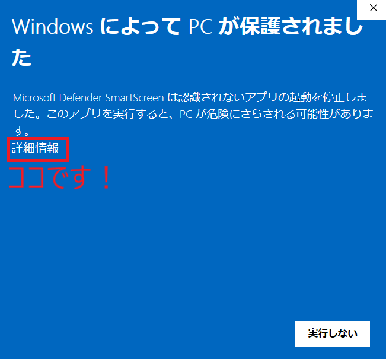

# TTP - Tera Term Pilot

テラタームマクロをGUIで管理・実行するツールです。  
接続情報は暗号化して保存されます。

## 特徴

- **ワンクリック接続**: 接続先を選んでクリックするだけ
- **AWS から接続 (v1.2.0)**: SSM / ECS Exec で「今つながる」EC2・Fargate を一覧から選択
- **接続情報の暗号化**: パスワード・秘密鍵・AWS アクセスキーはマスターパスワードで暗号化
- **自動ログ記録**: 接続時にログファイルが自動生成される（忘れない）
- **鍵ファイル管理**: 鍵はアプリ内に暗号化保存。接続設定を消せば鍵も消える
- **ttpmacro.exe 自動検出**: インストール済みのTera Termを自動検出
- **ポータブル**: zip解凍するだけ。アンインストールはフォルダ削除するだけ

## 基本機能と追加機能

TTP の本体は、**Tera Term マクロ（ttpmacro.exe）を起動・管理するツール** です。

| 区分 | 内容 | 必要なもの |
|---|---|---|
| **基本機能**（本体） | Tera Term マクロの起動、接続情報の暗号化保存、自動ログ記録 | Tera Term |
| **追加機能**（v1.2.0・任意） | SSM / ECS Exec で EC2・Fargate に接続 | Session Manager プラグイン |

AWS 接続は **Tera Term を使わない独立した追加機能** です（SSH の代わりに SSM / ECS Exec を使うため、Tera Term も sshd も不要）。
**使う人だけ** Session Manager プラグインを入れてください。使わない場合、追加のインストールも設定も不要で、従来の動作は変わりません。

## ドキュメント

- **[使い方マニュアル](docs/manual.md)** — インストール・セットアップ・各画面の操作方法

## 動作要件

- Windows 11
- Tera Term (ttpmacro.exe) がインストールされていること
- AWS から接続する場合のみ: Session Manager プラグイン（AWS CLI は不要）

## インストール

1. `ttp-x.x.x.zip` を任意の場所に解凍
2. `ttp.exe` をダブルクリック
3. 初回起動時にマスターパスワードを設定
4. ttpmacro.exe のパスを確認（自動検出されます）

### 初回起動時の警告について

コード署名を付けていないため、初回起動時に Microsoft Defender SmartScreen が
「Windows によって PC が保護されました」と表示されることがあります。



1. **「詳細情報」** をクリック
2. 表示された **「実行」** をクリック

で起動できます。2 回目以降は表示されません。

> ソースから自分でビルドして確かめることもできます（`uv sync` → `uv run python build.py`）。

## 使い方

1. 「新規追加」で接続先を登録
2. 接続先を選んで「接続」をクリック（またはダブルクリック）
3. ログは自動で `logs/` フォルダに保存される

## キーボードショートカット

| キー | 操作 |
|------|------|
| Enter / ダブルクリック | 接続 |
| Ctrl+N | 新規追加 |
| Ctrl+E | 編集 |
| Ctrl+D | 複製 |
| Delete | 削除 |
| Ctrl+L | ログフォルダを開く |
| Ctrl+, | 設定 |
| Ctrl+Shift+A | AWS から接続 |

## AWS から接続 (SSM / ECS Exec)

> **Tera Term を使わない追加機能です。** 本体（Tera Term マクロの起動）とは独立しており、
> 使わない場合は何も設定不要です。

SSH を立てずに、Session Manager / ECS Exec 経由でシェルに入ります。
SSH の鍵もインバウンドポートも不要です。

### 必要なもの

1. [Session Manager プラグイン](https://docs.aws.amazon.com/systems-manager/latest/userguide/session-manager-working-with-install-plugin.html)（**必須・これだけでOK**）
2. EC2 側: SSM Agent と `AmazonSSMManagedInstanceCore` 相当のインスタンスプロファイル
3. ECS 側: `enableExecuteCommand` を有効にしたタスク

AWS CLI v2 は不要です（インストール済みならフォールバックとして使われます）。
プラグインは TTP に同梱されていません。未導入の場合は「AWS から接続」を
開いたときにインストール案内のポップアップが表示されます。
インストール後は **TTP を再起動**してください（PATH の再読み込みが必要）。

### 使い方

1. メニューの「AWS」→「AWS 設定...」でアクセスキー・シークレット・リージョンを入力
2. 「接続テスト」で疎通確認
3. メニューの「AWS」→「AWS から接続...」（Ctrl+Shift+A）
4. 一覧から EC2 インスタンスまたは ECS タスクを選んでダブルクリック

一覧には **接続できるものだけ** を表示します。

- EC2: SSM に登録され `PingStatus=Online` のもの
- ECS: ECS Exec が有効で `ExecuteCommandAgent` が RUNNING のもの

### MFA について

IAM ユーザーに MFA が必須のポリシーを敷いている場合だけ、「AWS 設定」で
「MFA を使用する」を有効にしてください。接続時に 6 桁コードを入力します。
MFA を使っていないユーザーは何も入力不要です。

### 必要な IAM 権限（最小構成）

```json
{
  "Version": "2012-10-17",
  "Statement": [
    {
      "Effect": "Allow",
      "Action": [
        "ec2:DescribeInstances",
        "ecs:ListClusters",
        "ecs:ListTasks",
        "ecs:DescribeTasks",
        "ecs:ExecuteCommand",
        "ssm:DescribeInstanceInformation",
        "ssm:StartSession"
      ],
      "Resource": "*"
    },
    {
      "Effect": "Allow",
      "Action": [
        "ssmmessages:CreateControlChannel",
        "ssmmessages:CreateDataChannel",
        "ssmmessages:OpenControlChannel",
        "ssmmessages:OpenDataChannel"
      ],
      "Resource": "*"
    }
  ]
}
```

## 開発 (ソースから実行)

```bash
# 依存パッケージをインストール
uv sync

# 実行
uv run python -m ttp
```

## ビルド (exe作成)

```bash
uv run python build.py
```

`dist/ttp/` フォルダに `ttp.exe` が生成されます。  
フォルダごとzip圧縮して配布してください。

## リリース手順

### 自動（毎月）

`.github/workflows/update-deps.yml` が **毎月 1 日 3:00 JST** に動きます。

1. `uv lock --upgrade` で依存を最新化
2. スモークチェック・依存の脆弱性チェック
3. パッチバージョンを上げてコミット＋タグ push
4. 同じワークフロー内で exe をビルドし、GitHub Release を作成（zip 添付）

> `GITHUB_TOKEN` で push したタグは他のワークフローを起動しないため、
> 月次更新ではビルドとリリースを同じワークフロー内で行っています。
> `release.yml` は、人が手でタグを push したときに動作します。

変更が無かった月は何も起きません。手動で回す場合は Actions から
`Monthly dependency update` を `Run workflow` してください。

### 手動

```powershell
uv run python scripts/update_deps.py          # 依存更新 + スモークチェック
uv run python scripts/bump_version.py patch   # 例: 1.2.0 -> 1.2.1
uv run python build.py                        # exe と zip をビルド
git add -A
git commit -m "chore: release vX.Y.Z"
git tag vX.Y.Z
git push origin main --tags                   # タグ push でリリースが作られる
```

リリースノートを自分で書きたい場合は、タグを push せずに次を実行します
（`docs/release-notes/v1.2.0.md` をコピーして使うと楽です）。

```powershell
gh release create vX.Y.Z "dist/ttp-X.Y.Z.zip" `
  --title "vX.Y.Z" --notes-file docs/release-notes/vX.Y.Z.md
```

> `gh release create` がタグも作るため、後から `release.yml` が起動しますが、
> **既にリリースがあればスキップ**するので二重作成にはなりません。

## セキュリティと更新方針

- **Python**: 3.14 系を同梱しています（2027 年 10 月までバグ修正、
  2030 年 10 月までセキュリティサポート）。
  同梱されるランタイムは **ビルド時点の最新パッチ** です。
  `.python-version` は `3.14` にしてあり、古いパッチに固定されません。
- **依存パッケージ**: `boto3` / `cryptography` などは `uv.lock` で固定し、
  **毎月 1 日に自動で更新**してパッチリリースします。
- **依存の脆弱性検査**: CI（push / PR）、月次更新、リリース前の 3 か所で
  `pip-audit` を実行し、検出した場合はビルド・リリースを止めます。
- **TLS の CA**: `certifi` は使わず、`botocore` 同梱の CA バンドルで検証しています。
  2026 年 10 月の eMudhra / emSign 中間 CA 問題（CVE-2026-115557）について、
  同梱バンドルに該当する認証局のエントリが無いことを確認しています。
- **認証情報**: マスターパスワード由来の鍵で暗号化して `ttp_data/` に保存し、
  子プロセスへは環境変数でのみ渡します（コマンドラインには載せません）。
- **脆弱性が報告された場合**: 月次更新で取り込みます。緊急時は手動でリリースします。

## アップデート

**既存の ttp フォルダに上書き**してください（フォルダを移動・リネームすると設定が引き継げません）。

1. TTP を終了する
2. 新しい `ttp-x.x.x.zip` を展開する
3. 展開した中の **`ttp.exe` と `_internal` フォルダ** を、既存の ttp フォルダへ上書きコピー
4. `ttp.exe` を起動

`ttp_data/`（設定・暗号化データ）と `logs/` は上書きせず、そのまま残してください。
展開したフォルダごと置き換えると `logs/` が消えるので注意してください。

## アンインストール

フォルダを削除するだけです。  
接続設定・暗号化された鍵・ログもすべてフォルダ内に保存されているため、フォルダ削除で完全にクリーンアップされます。

## ライセンス

MIT License - 詳細は [LICENSE](LICENSE) をご確認ください。
