# TTP - Tera Term Pilot 使い方マニュアル

## TTP とは？

**TTP (Tera Term Pilot)** は、Tera Term マクロ (ttpmacro.exe) を GUI で管理・実行するための Windows デスクトップアプリケーションです。

> **TTP の中心は Tera Term マクロの起動です。**
> v1.2.0 で追加した AWS 接続（SSM / ECS Exec）は、Tera Term を使わない
> **任意の追加機能** です。使う人だけ Session Manager プラグインをインストールしてください。
> 使わない場合、従来の機能と設定は一切変わりません。

### こんな悩みを解決します

| よくある困りごと | TTP なら |
|---|---|
| 接続先ごとにマクロファイルを手書きしている | GUI で登録するだけ。マクロは自動生成 |
| パスワードがマクロ内に **平文で書かれている** | AES 暗号化で保存。マクロファイルにパスワードは残らない |
| 秘密鍵ファイルのパスを毎回探している | 一度パスを登録すればワンクリック接続 |
| ログを取り忘れる | 接続時に **自動でログファイルを生成**。忘れることがない |
| Tera Term の設定をチームで共有しにくい | ポータブル設計。フォルダごとコピーするだけ |

### 特徴

- **ワンクリック接続** — 接続先を選んでダブルクリックするだけ
- **接続情報の暗号化** — パスワード・接続情報はマスターパスワードで暗号化 (AES-256 / Fernet)
- **自動ログ記録** — 接続時にタイムスタンプ付きログファイルが自動生成される
- **ttpmacro.exe 自動検出** — インストール済みの Tera Term を自動検出
- **ポータブル** — zip を解凍するだけで使える。レジストリ不使用
- **MIT ライセンス** — 商用利用含め自由に利用可能

---

## インストール

### 動作要件

- **OS**: Windows 11（Windows 10 は Microsoft のサポートが終了しているため非推奨）
- **Tera Term**: Tera Term 4 または Tera Term 5 がインストールされていること（ttpmacro.exe が必要）

### 手順

1. `ttp-x.x.x.zip` を任意のフォルダに展開します
2. 展開先には以下のファイルが含まれています

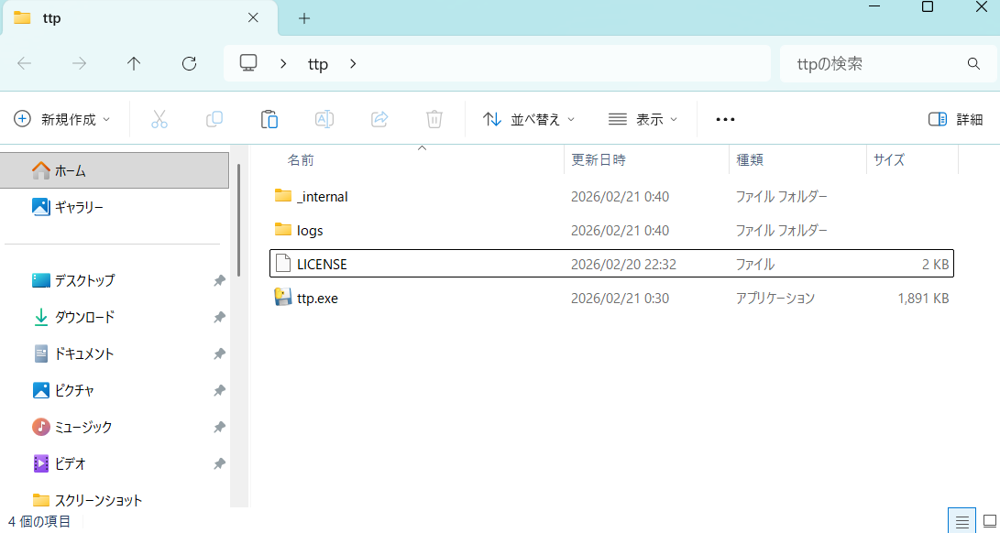

> **ヒント**: デスクトップや `C:\Tools\ttp\` など、分かりやすい場所に置くのがおすすめです。  
> Program Files 配下は権限の問題が起きる場合があるため避けてください。  
> **注意**: セットアップ後にフォルダ名やフォルダの場所を変更すると、設定の再構成が必要になります（[トラブルシューティング](#フォルダ名やフォルダの場所を変更したら接続できなくなった)参照）。

3. `ttp.exe` をダブルクリックして起動します

#### 初回起動時に警告が出た場合

コード署名を付けていないため、初回起動時に Microsoft Defender SmartScreen が
「Windows によって PC が保護されました」と表示されることがあります。

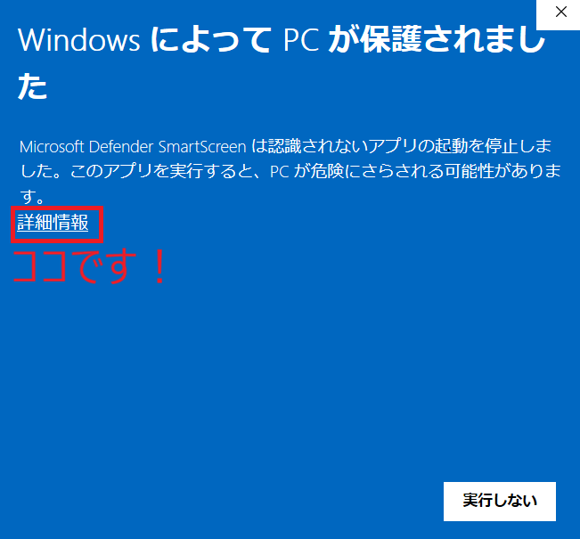

1. 赤枠の **「詳細情報」** をクリック
2. 表示された **「実行」** をクリック

で起動できます。2 回目以降は表示されません。

> **なぜ表示されるの？** TTP は個人が配布している実行ファイルで、コード署名証明書を
> 使っていないためです。内容を確かめたい場合は、配布元の GitHub リポジトリ
> （https://github.com/okamoto53515606/ttp）のソースから
> `uv run python build.py` で自分でビルドすることもできます。

---

## アップデート

**既存の ttp フォルダに上書き**してください。
フォルダ名や場所を変えると、保存済みの設定（ログ保存先など）が引き継げません。

### 手順

1. TTP を終了する
2. 必要に応じて、現在の ttp フォルダを丸ごとコピーしてバックアップする
3. 新しい `ttp-x.x.x.zip` を展開する
4. 展開したフォルダの中から、次の 2 つを既存の ttp フォルダへ上書きコピーする
   - `ttp.exe`
   - `_internal` フォルダ
5. `ttp.exe` を起動し、接続先一覧が表示されることを確認する

> **上書きしないもの**: `ttp_data/` と `logs/`
> これらは設定・暗号化データ・ログの保存先です。残しておけば、接続先や
> マスターパスワードを再設定せずに済みます。

> **注意**: 展開したフォルダごと置き換えると `logs/` が消えます。
> 必ず「中身をコピーして上書き」してください。

---

## アンインストール

**フォルダごと削除するだけ** で完了です。

TTP はレジストリや AppData などの外部フォルダにデータを一切保存しません。  
接続設定・暗号化データ・ログもすべて TTP フォルダ内に保存されているため、フォルダを削除すればクリーンアップは完了です。

---

## 初回セットアップ

### 1. マスターパスワードの設定

TTP を初めて起動すると、マスターパスワードの設定画面が表示されます。

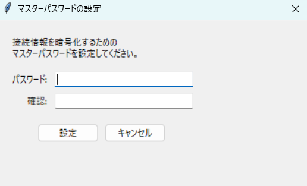

#### マスターパスワードとは？

マスターパスワードは、登録した接続情報（ホスト名・ユーザ名・パスワード等）を **暗号化するための鍵** です。

- 接続情報は **AES-256 (Fernet) で暗号化** されてディスクに保存されます
- マスターパスワードから暗号鍵を導出する際は **PBKDF2 (480,000回反復)** を使用しており、総当たり攻撃に対して強固です
- マスターパスワード自体は保存されません（検証用トークンのみ保存）

#### よくある質問

| 質問 | 回答 |
|---|---|
| **毎回同じ値を入力するの？** | はい。起動のたびに同じマスターパスワードを入力してください。これにより接続情報が復号されます |
| **間違えるとどうなる？** | 「パスワードが違います」と表示されます。**3回間違えるとアプリが終了** します。再度起動すればまた3回試行できます |
| **忘れたらどうなる？** | 接続情報を復号できなくなります。`ttp_data` フォルダを削除して最初から設定し直す必要があります |
| **後から変更できる？** | はい。メニューの「ファイル → マスターパスワード変更」から変更できます。接続情報は新しいパスワードで自動的に再暗号化されます |
| **4文字未満は設定できる？** | いいえ。セキュリティのため4文字以上が必要です |

### 2. ttpmacro.exe の選択

マスターパスワードの設定後、ttpmacro.exe の選択画面が表示されます。

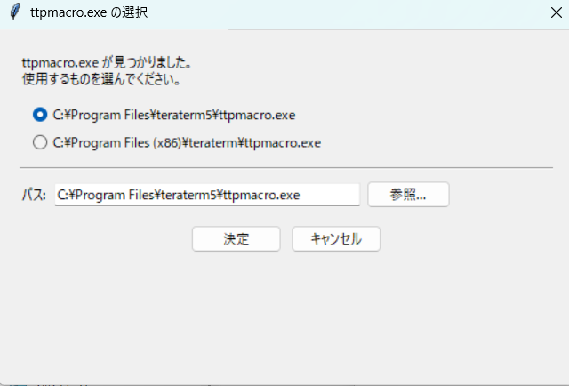

- TTP は以下の場所を **自動検索** します:
  - `C:\Program Files\teraterm5\ttpmacro.exe` (Tera Term 5)
  - `C:\Program Files (x86)\teraterm5\ttpmacro.exe`
  - `C:\Program Files\teraterm\ttpmacro.exe` (Tera Term 4)
  - `C:\Program Files (x86)\teraterm\ttpmacro.exe`
- 自動検出された ttpmacro.exe がラジオボタンで表示されるので、使用したいものを選んで「決定」を押してください
- 見つからない場合は「参照...」ボタンから手動で選択できます

> **注意**: Tera Term 5 と Tera Term 4 の両方がインストールされている場合、両方が表示されます。通常は新しいバージョン (Tera Term 5) の選択を推奨します。

---

## 接続先一覧画面

初回セットアップが完了すると、メインの接続先一覧画面が表示されます。

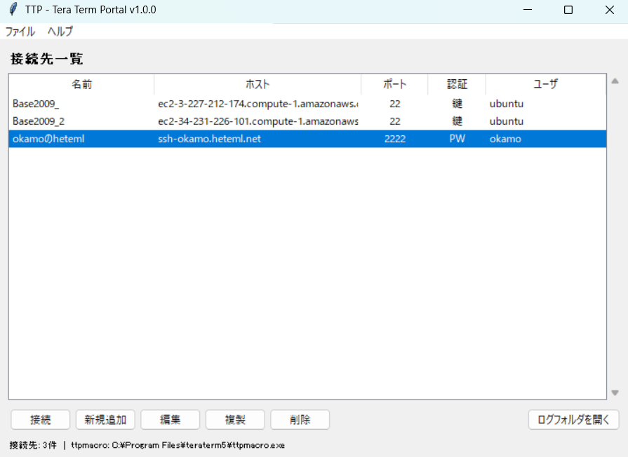

### 画面構成

| 要素 | 説明 |
|---|---|
| **接続先一覧 (テーブル)** | 登録済みの接続先が一覧表示されます。名前・ホスト・ポート・認証方式・ユーザ名が確認できます |
| **接続** ボタン | 選択した接続先に Tera Term で接続します |
| **新規追加** ボタン | 新しい接続先を登録します |
| **編集** ボタン | 選択した接続先の設定を変更します |
| **複製** ボタン | 選択した接続先をコピーして新しいエントリを作成します（似た設定の接続先を素早く追加できます） |
| **削除** ボタン | 選択した接続先を削除します（確認ダイアログが表示されます） |
| **ログフォルダを開く** ボタン | ログの保存先フォルダをエクスプローラーで開きます |

### 接続方法

1. 一覧から接続先を選択
2. **ダブルクリック** または **「接続」ボタン** をクリック（Enter キーでも可）
3. Tera Term が起動し、SSH 接続とログ記録が自動的に開始されます

### テーブルの操作

- **列ヘッダーをクリック** すると、その列でソートできます（クリックするたびに昇順/降順が切り替わります）

### キーボードショートカット

| キー | 操作 |
|---|---|
| `Enter` / ダブルクリック | 接続 |
| `Ctrl + N` | 新規追加 |
| `Ctrl + E` | 編集 |
| `Ctrl + D` | 複製 |
| `Delete` | 削除 |
| `Ctrl + L` | ログフォルダを開く |
| `Ctrl + ,` | 設定 |

---

## 接続先の登録・編集

「新規追加」または「編集」をクリックすると、接続先の登録画面が開きます。

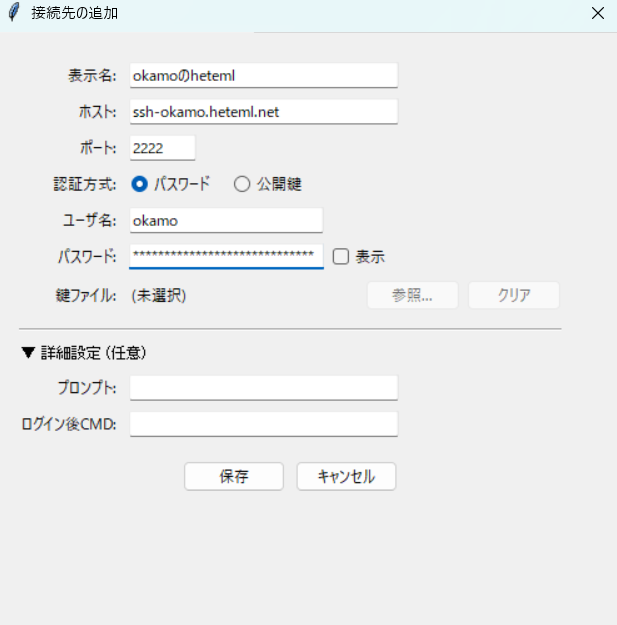

### 基本設定

| 項目 | 説明 | 例 |
|---|---|---|
| **表示名** | 一覧に表示される名前（自由に付けられます） | `本番サーバ A` |
| **ホスト** | 接続先のホスト名または IP アドレス | `192.168.1.100` |
| **ポート** | SSH ポート番号（デフォルト: 22） | `22` |
| **認証方式** | 「パスワード」または「公開鍵」を選択 | — |
| **ユーザ名** | SSH ログインユーザ名 | `admin` |
| **パスワード** | SSH パスワード（「表示」チェックで平文表示可能） | — |
| **鍵ファイル** | 公開鍵認証時の秘密鍵ファイルパス（参照ボタンで選択） | `C:\Users\user\.ssh\id_rsa` |

> **パスワードの安全性**: 入力したパスワードはマスターパスワードで暗号化されて保存されます。ディスク上に平文では残りません。  
> **鍵ファイル**: TTP は鍵ファイル自体をコピーせず、ファイルパスだけを記録します。鍵ファイルを移動・削除した場合は、接続先の編集で再指定してください。

### 詳細設定（任意）

接続先の登録画面の下部にある「詳細設定」セクションでは、ログイン後の自動操作を設定できます。

| 項目 | 説明 |
|---|---|
| **プロンプト** | ログイン後に待機するプロンプト文字列 |
| **ログイン後 CMD** | プロンプト検出後に自動送信するコマンド |

#### 活用例

**例1: ログイン後に特定のディレクトリへ移動**

| 項目 | 値 |
|---|---|
| プロンプト | `$` |
| ログイン後 CMD | `cd /var/log/app && tail -f app.log` |

**例2: su でスーパーユーザに切り替え**

| 項目 | 値 |
|---|---|
| プロンプト | `$` |
| ログイン後 CMD | `su -` |

> **動作の仕組み**: TTP は Tera Term マクロの `wait` コマンドでプロンプト文字列を待ち、検出されたら `sendln` コマンドでログイン後 CMD を送信します。  
> プロンプトを空にした場合、ログイン後の自動操作は行われません。

### 踏み台（多段接続）設定 <sup>v1.1.0 追加</sup>

「☑ 踏み台経由で接続する」にチェックを入れると、踏み台サーバ経由で別のサーバに自動ログインする設定が表示されます。

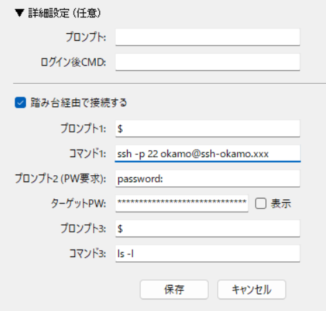

| 項目 | 説明 | 例 |
|---|---|---|
| **プロンプト1** | 踏み台ログイン後のプロンプト | `$` |
| **コマンド1** | 踏み台で実行するコマンド | `ssh user@192.168.1.10` |
| **プロンプト2 (PW要求)** | ターゲットのパスワードプロンプト | `password:` |
| **ターゲットPW** | ターゲットサーバのパスワード | — |
| **プロンプト3** | ターゲットログイン後のプロンプト | `$` |
| **コマンド3** | ターゲットで実行するコマンド | `sudo systemctl status nginx` |

#### 処理の流れ

```
[踏み台にSSH接続]
  → プロンプト1 を待つ
  → コマンド1 を送信（例: ssh user@target）
  → プロンプト2 を待つ（例: password:）
  → ターゲットPW を送信
  → プロンプト3 を待つ
  → コマンド3 を送信
```

> **注意**: 踏み台経由時は接続タイムアウトが自動的に **15秒** に延長されます（通常は5秒）。  
> プロンプト文字列は Tera Term の `wait` コマンドによる部分一致です。`$` や `#` など、画面に表示される文字列の一部を指定してください。  
> **ターゲットPW も踏み台PW と同様に暗号化されて保存されます。**

#### 事前準備: SSH ホスト鍵の確認について

初めて接続するサーバでは、sshコマンドが以下のような確認ダイアログを表示します：

```
Are you sure you want to continue connecting (yes/no)?
```

このダイアログは TTP マクロでは自動処理できません。**事前に 踏み台サーバからsshコマンドで手動ログインし、ホスト鍵を受け入れておいてください。** 一度受け入れれば次回以降は表示されなくなります。

- 踏み台サーバとターゲットサーバの **両方** について、事前に手動ログインしてホスト鍵を登録しておく必要があります
- Tera Term のホスト鍵キャッシュは `TERATERM.INI` の設定に従います（デフォルトではレジストリに保存）

---

## AWS から接続（SSM / ECS Exec） <sup>v1.2.0 追加</sup>

SSH の代わりに、AWS Systems Manager（Session Manager）と ECS Exec で
シェルに入る機能です。**sshd のインストールも、インバウンドポートの開放も不要**です。

> これは **Tera Term を使わない追加機能** です。TTP の本体（Tera Term マクロの起動）とは
> 独立しており、使わない場合は何も設定する必要はありません。

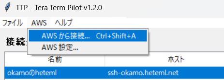

メニューの「AWS」から次の 2 つを開けます。

| メニュー | 用途 |
|---|---|
| AWS 設定... | アクセスキー・リージョン・MFA の設定 |
| AWS から接続...（Ctrl+Shift+A） | 接続先の一覧 |

### 1. 必要なツールを入れる

この機能を使うには **Session Manager プラグイン** が必要です。
**TTP には同梱されていません**ので、各自インストールしてください。

| ツール | 要否 | サイズ目安 |
|---|---|---|
| Session Manager プラグイン | **必要**（これを入れれば完結） | 10〜20MB |
| AWS CLI v2 | 任意（プラグインが無い場合の代替） | 約 250MB |

> v1.2.0 以降、AWS CLI が無くてもプラグインだけで接続できます。

#### Session Manager プラグインのインストール

1. 次のページを開く

   https://docs.aws.amazon.com/systems-manager/latest/userguide/session-manager-working-with-install-plugin.html

2. 「Windows」の項目から 64 ビット版の MSI をダウンロード
3. ダウンロードした MSI を実行する

   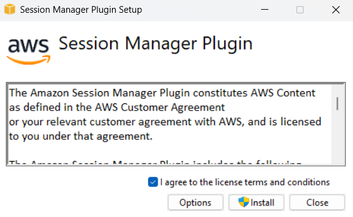

   「I agree to the license terms and conditions」にチェックを入れ、
   「Install」を押します。

4. PowerShell を開いて、次のコマンドで確認

```powershell
session-manager-plugin --version
```

バージョン番号が表示されれば成功です。

> **注意（zip 版は非推奨）**: 「SessionManagerPlugin.zip」を展開して `install.bat` を
> 管理者で実行する方法もありますが、最後の「Set environment path variable.」で
> 止まることがあります。**MSI（SessionManagerPluginSetup.exe）を推奨**します。
>
> 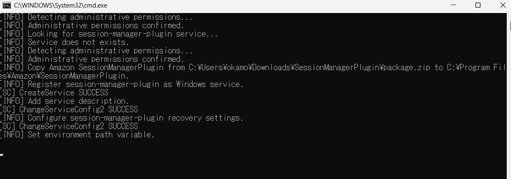
>
> zip 版で止まった場合でも、`C:\Program Files\Amazon\SessionManagerPlugin\bin\` に
> ファイルが配置されていれば **TTP はそのまま使えます**（PATH が未設定でも
> 既定のフォルダを探します）。また zip 版は不要な `session-manager-plugin`
> サービスを登録するので、気になる場合は管理者 PowerShell で
> `sc.exe delete session-manager-plugin` を実行してください。

#### （任意）AWS CLI v2 のインストール

Session Manager プラグインを入れた場合は不要です。
プラグインを入れられない環境での代替手段として使えます。

1. 次のページを開く

   https://docs.aws.amazon.com/cli/latest/userguide/getting-started-install.html

2. 「Windows」の MSI をダウンロードして実行
3. PowerShell で確認

```powershell
aws --version
```

#### インストール後にやること

- **TTP を再起動してください。** PATH はプロセス起動時に読み込まれるため、
  TTP を開いたままインストールした場合は再起動が必要です。
- ツールが見つからない場合、TTP は「AWS から接続」を開いたとき、
  および接続しようとしたときに **ポップアップで案内**します。
  ポップアップの「ページを開く」ボタンからダウンロードページを開けます。
- Session Manager プラグインと AWS CLI の**どちらか一方**があれば接続できます。

### 2. AWS 設定を登録する

1. メニューの「AWS」→「AWS 設定...」を開く
2. 次の 3 つを入力する
   - アクセスキー ID
   - シークレットアクセスキー
   - リージョン
3. 必要なら「接続テスト」を押す（アカウント ID と ARN が表示されます）
4. 「保存」を押す

入力値はマスターパスワード由来の鍵で暗号化され、`ttp_data/aws.enc` に保存されます。

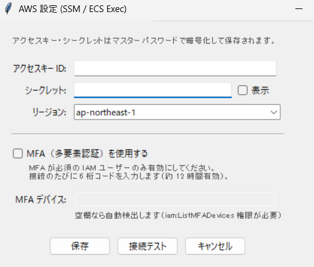

### 3. MFA を使っている場合

IAM ユーザーに「MFA 必須」のポリシーを敷いている場合だけ、
「MFA を使用する」にチェックを入れてください。

- 接続時に 6 桁コードの入力ダイアログが出ます
- 一度入力すると約 12 時間は再利用されます
- **MFA を使っていないユーザーは何も入力不要**です

MFA デバイスの欄が空欄なら、自動検出を試みます
（`iam:ListMFADevices` 権限が必要）。失敗する場合は ARN を直接入力してください。

### 4. 接続する

1. メニューの「AWS」→「AWS から接続...」（Ctrl+Shift+A）
2. 一覧が表示されるので、対象をダブルクリック

```
EC2 (2)
  web-prod-01        Online    t3.micro / Linux / 10.0.1.23
ECS (3)
  cluster-prod (3)
    svc-api (2)
      3f9a1c2d4e5f   Exec 可   app:12 / FARGATE / 2026-10-31 09:00 / app
```

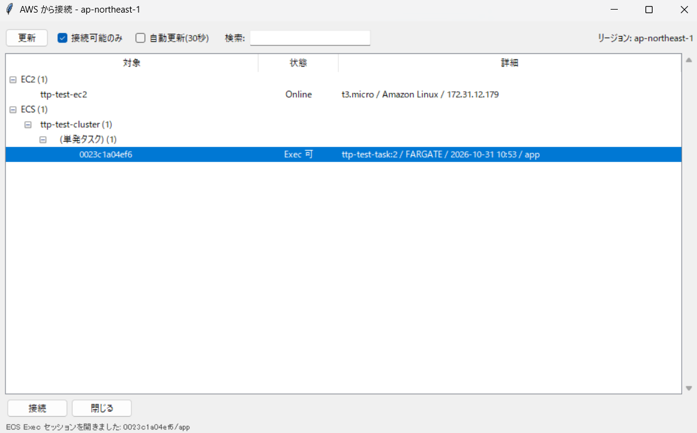

一覧の見方:

| 表示 | 意味 |
|---|---|
| Online | SSM 経由で接続できる |
| SSM 未登録 | SSM Agent が無い、またはネットワーク到達不可 |
| Exec 可 | ECS Exec で接続できる |
| Exec 無効 | タスクで ECS Exec が無効（新規起動が必要） |

「接続可能のみ」のチェックを外すと、接続できないものもグレー表示されます
（原因調査用）。「更新」（F5）で最新の状態を取り直します。

> **起動直後のタスクは一時的に非表示になります。** Fargate タスクは起動後、
> `ExecuteCommandAgent` が RUNNING になるまで数十秒かかります。その間は
> 「接続可能のみ」が ON だと一覧に出ません。ステータスバーに
> 「非表示 N 件（接続可能のみ ON）」と表示されるので、少し待って再更新してください。

**「自動更新(30秒)」** にチェックすると、30 秒ごとに一覧を取り直します。
サービス配下のタスクはデプロイやスケールで入れ替わるため、これを入れておくと
追従できます。MFA の有効期限が切れた場合は自動更新を止めて案内を表示します
（勝手にコード入力ダイアログは出しません）。

ECS のタスクは **新しい順（起動日時の降順）** に並びます。
デプロイ直後のタスクを探すときに便利です。

#### 接続後の画面

EC2（SSM）に接続すると、`ssm-user` でシェルが開きます。

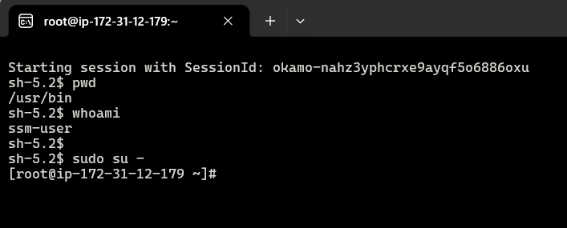

Fargate（ECS Exec）に接続すると、コンテナ内のシェルが開きます（既定では `root`）。

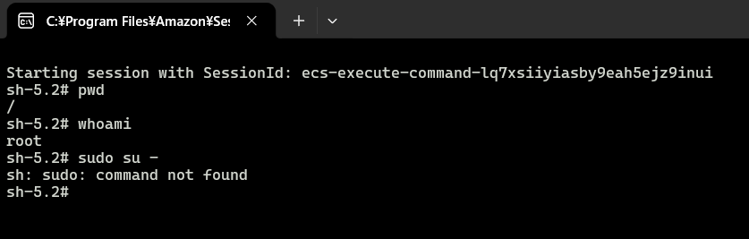

> **補足**: コンテナ内には `sudo` が入っていないことが多いため、`sudo su -` は
> `sh: sudo: command not found` になります。ECS Exec は既定で `root` なので実行不要です。

### 5. トラブルシューティング

| 症状 | 対処 |
|---|---|
| 「必要なツールがありません」 | Session Manager プラグイン（または AWS CLI v2）を入れて TTP を再起動 |
| `install.bat` が「Set environment path variable.」で止まる | ウィンドウを閉じてよい。TTP は既定のフォルダを探すので動作する（MSI 版推奨） |
| 一覧が古い | 「更新」（F5）または「自動更新(30秒)」を使う |
| EC2 が一覧に出ない | SSM Agent の稼働、インスタンスプロファイル、VPC エンドポイントを確認 |
| EC2 が「SSM 未登録」 | 上記に加え、アウトバウンド 443 が通っているか確認 |
| ECS タスクが「Exec 無効」 | `enableExecuteCommand=true` で新しいタスクを起動する（既存タスクには後付け不可） |
| 認証エラー | アクセスキー・シークレット・リージョンを確認。「接続テスト」で切り分け |
| MFA エラー | 「MFA を使用する」を有効にし、コードを入力 |
| 20 分で切れる | Session Manager のアイドルタイムアウト（設定で延長可能） |

## ログフォルダを開く

「ログフォルダを開く」ボタンをクリックすると、ログの保存先がエクスプローラーで開きます。

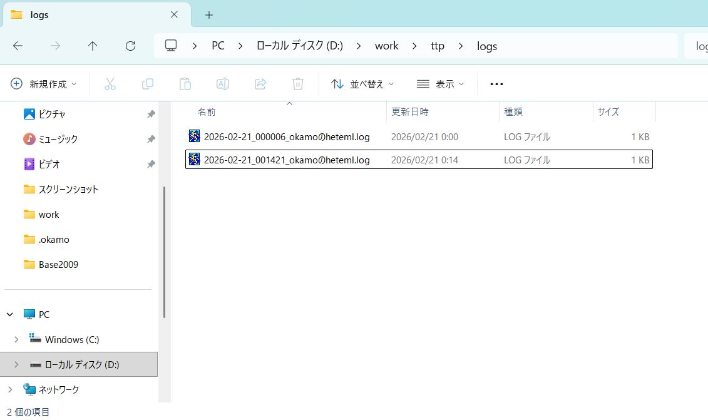

### ログファイルについて

- 接続するたびに自動的にログファイルが作成されます
- ファイル名の形式: `YYYY-MM-DD_HHMMSS_接続先名.log`
  - 例: `2026-02-21_143052_本番サーバA.log`
- ログの保存先はデフォルトで TTP フォルダ内の `logs/` ですが、設定画面で変更できます

---

## 設定画面

メニューの「ファイル → 設定...」または `Ctrl + ,` で設定画面を開けます。

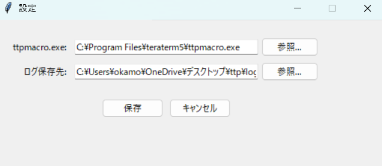

| 項目 | 説明 |
|---|---|
| **ttpmacro.exe** | 使用する ttpmacro.exe のフルパス。「参照...」で変更可能 |
| **ログ保存先** | ログファイルの保存先フォルダ。「参照...」で変更可能 |

### 設定の活用例

- **Tera Term のバージョンを切り替えたい**: ttpmacro.exe のパスを Tera Term 5 / 4 のものに変更
- **ログをネットワークドライブに保存したい**: ログ保存先を `\\server\share\logs` のように UNC パスに変更
- **プロジェクトごとにログを分けたい**: ログ保存先をプロジェクト名のフォルダに変更（例: `D:\logs\projectA`）

---

## フォルダ構成

TTP のフォルダ内には以下のファイル・フォルダが存在します。

```
ttp/
├── ttp.exe            ... TTP 本体
├── LICENSE            ... ライセンスファイル (MIT)
├── _internal/         ... TTP の実行に必要な内部ファイル（※触らないでください）
├── ttp_data/          ... 接続設定・暗号化データの保存先
│   ├── master.json    ... マスターパスワードの検証情報 (salt + トークン)
│   ├── connections.enc ... 暗号化された接続情報
│   └── settings.json   ... アプリケーション設定 (ttpmacroパス、ログ保存先)
└── logs/              ... ログファイルの保存先 (デフォルト)
    ├── 2026-02-21_143052_本番サーバA.log
    └── ...
```

### 各フォルダの詳細

| フォルダ / ファイル | 説明 |
|---|---|
| `ttp.exe` | アプリ本体の実行ファイル。ダブルクリックで起動します |
| `LICENSE` | MIT ライセンスファイル |
| `_internal/` | Python ランタイムや暗号化ライブラリなどの内部ファイルが格納されています。**このフォルダの中身は変更・削除しないでください**。アプリが動作しなくなります |
| `ttp_data/` | TTP が管理するデータの保存先です。接続情報の暗号化ファイル、マスターパスワードの検証情報、設定ファイルが含まれます |
| `ttp_data/master.json` | マスターパスワードの salt と検証用トークンが保存されています。パスワード自体は保存されていません |
| `ttp_data/connections.enc` | 接続情報が AES-256 で暗号化されたバイナリファイルです。マスターパスワードなしでは復号できません |
| `ttp_data/settings.json` | ttpmacro.exe のパスやログ保存先などのアプリケーション設定です（平文 JSON） |
| `logs/` | 接続時に自動生成されるログファイルの保存先です（設定で変更可能）。このフォルダは自由に整理・削除しても TTP の動作に影響しません |

> **バックアップ**: TTP フォルダをそのままコピーすればデータも含めてバックアップできます。  
> **別 PC への移行**: フォルダごとコピーするだけで移行できます。ただし、鍵ファイルのパスは PC ごとに異なる場合があるため、移行先で再設定が必要になることがあります。

---

## トラブルシューティング

### フォルダ名やフォルダの場所を変更したら接続できなくなった

TTP はセットアップ時にログ保存先を **絶対パス** で `ttp_data/settings.json` に記録しています。  
フォルダ名を変更したり別の場所に移動した場合、旧パスが残って接続に失敗することがあります。

**対処方法**: 設定画面（`Ctrl + ,`）を開き、ログ保存先を正しいパスに修正してください。  
または、ログ保存先を空欄にすれば TTP フォルダ内の `logs/` が自動的に使用されます。

> **推奨**: セットアップ後はフォルダ名やフォルダの場所を変更しないでください。

### マスターパスワードを忘れた

`ttp_data` フォルダを削除して TTP を再起動してください。新しいマスターパスワードを設定できますが、以前の接続情報は失われます。

### ttpmacro.exe が見つからない

Tera Term がインストールされていることを確認してください。インストール先がデフォルト以外の場合は、設定画面（`Ctrl + ,`）から手動で ttpmacro.exe のパスを指定してください。

### 接続できない

- 接続先のホスト名・ポート・ユーザ名・パスワードが正しいか確認してください
- 公開鍵認証の場合、鍵ファイルのパスが正しく存在するか確認してください
- ファイアウォールやネットワーク設定により接続がブロックされていないか確認してください

### ログが保存されない

設定画面でログ保存先のフォルダパスが正しいか、書き込み権限があるか確認してください。

---

## ライセンス

TTP は **MIT License** のもとで公開されています。商用・非商用を問わず自由に利用できます。

詳細は [LICENSE](../LICENSE) をご確認ください。
