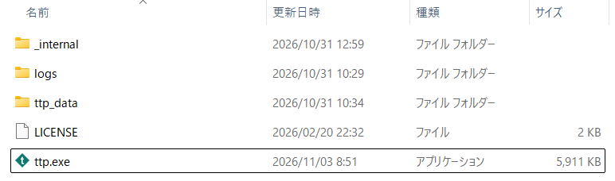

# TTP v1.2.3

アプリアイコンを追加しました。**機能的な変更はありません。**

## 内容

| 変更 | 内容 |
|---|---|
| アイコン | `ttp.exe` とウィンドウ（タスクバー・タイトルバー）にアイコンを追加 |
| ビルド | PyInstaller に `--icon=resources/ttp.ico` を指定 |
| 開発 | `scripts/make_icon.py` で `resources/ttp.ico` / `ttp.png` を再生成（Pillow は開発用依存のみ） |
| バージョン | 1.2.2 → 1.2.3 |

アイコンの図柄は「ひし形 + 白い `t`」で、色は teal（`#0f766e`）です。
色や文字を変えたい場合は `scripts/make_icon.py` の `FILL` / `LETTER` を編集して
`uv run python scripts/make_icon.py` を実行してください。

依存パッケージの更新はありません。
**実行ファイルの動作は v1.2.2 と同一**です（アイコンとバージョン表記のみ異なります）。

## アップデート方法（既存ユーザー向け）

**既存の ttp フォルダに上書き**してください。
フォルダを移動・リネームすると、ログ保存先などの設定（絶対パス）が引き継げません。

1. TTP を終了する
2. 必要に応じて、現在の ttp フォルダを丸ごとコピーしてバックアップする
3. `ttp-1.2.3.zip` を展開する
4. 展開した中の **`ttp.exe` と `_internal` フォルダ** を、既存の ttp フォルダへ上書きコピー
5. `ttp.exe` を起動する

> `ttp_data/`（接続設定・暗号化データ）と `logs/` は上書きしないでください。
> そのまま残せば、接続先やマスターパスワードを再設定せずに済みます。
> 展開したフォルダごと置き換えると `logs/` が消えるので注意してください。

> Windows のアイコンキャッシュが残っている場合、フォルダ内の `ttp.exe` の
> アイコンが古いまま見えることがあります。その場合は Explorer を再起動するか、
> `ie4uinit.exe -show` を実行してください。

## インストール（初めての方）

1. 下の `ttp-1.2.3.zip` をダウンロード
2. 任意のフォルダに解凍
3. `ttp.exe` を実行

初回起動時に Microsoft Defender SmartScreen の警告が出る場合があります
（「詳細情報」→「実行」）。

**フルチェンジログ**: https://github.com/okamoto53515606/ttp/compare/v1.2.2...v1.2.3
