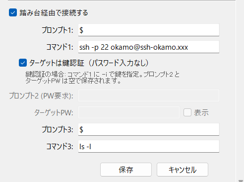

# TTP v1.3.0

踏み台（多段接続）で、**ターゲットが鍵認証**の場合に対応しました。

これまでは踏み台から先の接続がパスワード認証であることを前提に、
「プロンプト2（PW要求）」と「ターゲットPW」の両方を埋める必要がありました。
ターゲットが鍵認証の場合はどちらも空にする必要がありますが、画面からは
「未入力のままでよい」ことが分かりにくい状態でした。

今回、踏み台設定に **「ターゲットは鍵認証（パスワード入力なし）」** の
チェックボックスを追加し、チェックすると PW 関連の 2 項目が無効化され、
保存時も空で保存されるようにしました。



## 変更

| 変更 | 内容 |
|---|---|
| 接続先の編集（踏み台） | 「ターゲットは鍵認証（パスワード入力なし）」チェックを追加 |
| UI | チェック時は「プロンプト2」「ターゲットPW」「表示」をグレーアウトし、入力不可に |
| 保存データ | 鍵認証時は `hop_prompt2` / `hop_password` を空で保存 |
| マクロ | 鍵認証時は `TT_TTL_HOP_PROMPT2` / `TT_TTL_HOP_PASSWORD` を空で渡し、PW 待ち・PW 送信を行わない |
| ダイアログ | 項目追加に合わせて高さを 680 → 720 に拡張 |
| バージョン | 1.2.3 → 1.3.0 |

## 使い方

1. 接続先の編集画面で「☑ 踏み台経由で接続する」をチェック
2. 「☑ ターゲットは鍵認証（パスワード入力なし）」をチェック
3. 「コマンド1」に鍵を指定した ssh コマンドを入力

```
ssh -i ~/.ssh/id_rsa user@192.168.1.10
```

プロンプト1 → コマンド1 → プロンプト3 → コマンド3 の順に進みます
（プロンプト2 とターゲットPW は使用されません）。

> **鍵にパスフレーズがある場合** はチェックを外し、プロンプト2 に
> `Enter passphrase`、ターゲットPW にパスフレーズを設定してください。

## 既存設定への影響

- 既存の踏み台設定（パスワード認証）は **そのまま動作** します
- 新項目の既定値は「チェックなし」なので、保存済みデータの変換は不要です
- 保存済みの接続先も、編集画面を開いてチェックを入れれば切り替えられます

## アップデート方法（既存ユーザー向け）

**既存の ttp フォルダに上書き**してください。
フォルダを移動・リネームすると、ログ保存先などの設定（絶対パス）が引き継げません。

1. TTP を終了する
2. 必要に応じて、現在の ttp フォルダを丸ごとコピーしてバックアップする
3. `ttp-1.3.0.zip` を展開する
4. 展開した中の **`ttp.exe` と `_internal` フォルダ** を、既存の ttp フォルダへ上書きコピー
5. `ttp.exe` を起動する

> `ttp_data/`（接続設定・暗号化データ）と `logs/` は上書きしないでください。
> そのまま残せば、接続先やマスターパスワードを再設定せずに済みます。
> 展開したフォルダごと置き換えると `logs/` が消えるので注意してください。

## インストール（初めての方）

1. 下の `ttp-1.3.0.zip` をダウンロード
2. 任意のフォルダに解凍
3. `ttp.exe` を実行

初回起動時に Microsoft Defender SmartScreen の警告が出る場合があります
（「詳細情報」→「実行」）。

**フルチェンジログ**: https://github.com/okamoto53515606/ttp/compare/v1.2.3...v1.3.0
